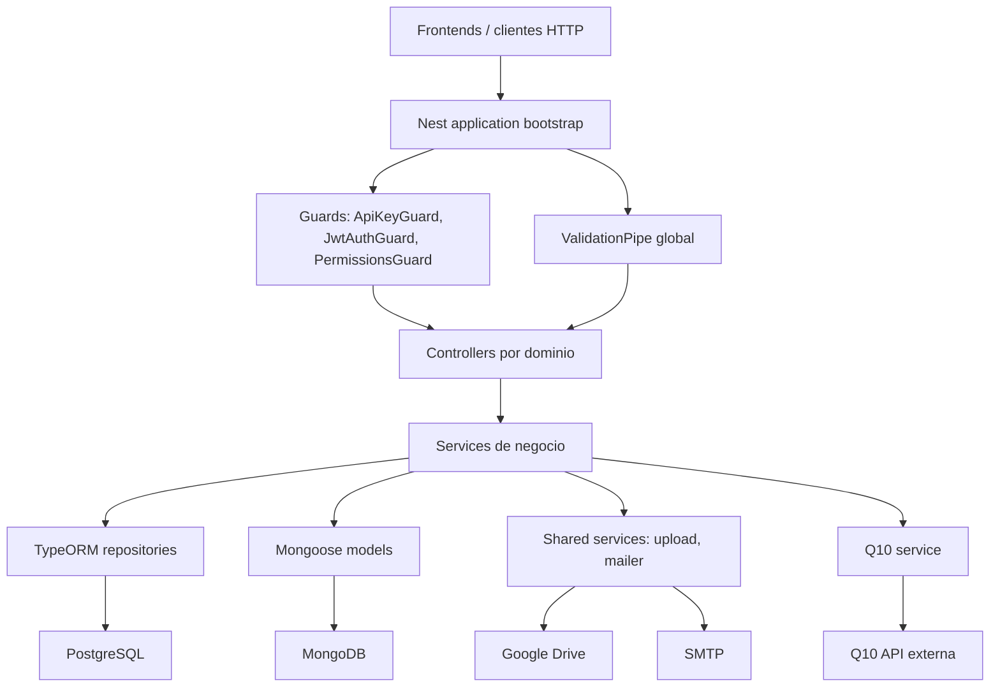

# Contenedores y Capas

## Bootstrap

`src/main.ts` crea la aplicacion, habilita CORS para dominios conocidos, aplica `ValidationPipe` global y configura Helmet. La app escucha en `PORT` o `3000`.

## Modulo raiz

`src/app.module.ts` configura:

- `ConfigModule.forRoot` global.
- `JwtModule` y `PassportModule`.
- `TypeOrmModule.forRootAsync` para PostgreSQL.
- `MongooseModule.forRootAsync` para MongoDB.
- Modulos funcionales bajo `src/modules`.
- Integraciones `Q10Module`, `UploadModule` y `MailerModule`.

## Convenciones de modulo

Cada feature debe mantener:

- Controller para rutas HTTP.
- Service para logica de negocio.
- DTOs para request payloads.
- Entity TypeORM o Schema Mongoose segun persistencia.
- Tests unitarios en `*.spec.ts`.

## Contratos y verificacion

OpenAPI ya esta configurado mediante SwaggerModule y metadata por operacion. El plugin compila DTOs, entidades y schemas; exportacion aislada y pruebas se describen en [OpenAPI](../api/openapi.md).

Los reportes certificadosr/tiempos consultan MongoDB y PostgreSQL sin almacenamiento propio. Recuperacion de contrasena guarda tokens hash en PostgreSQL y usa SMTP. Ninguna capa comparte una transaccion distribuida entre PostgreSQL, MongoDB y Drive.
