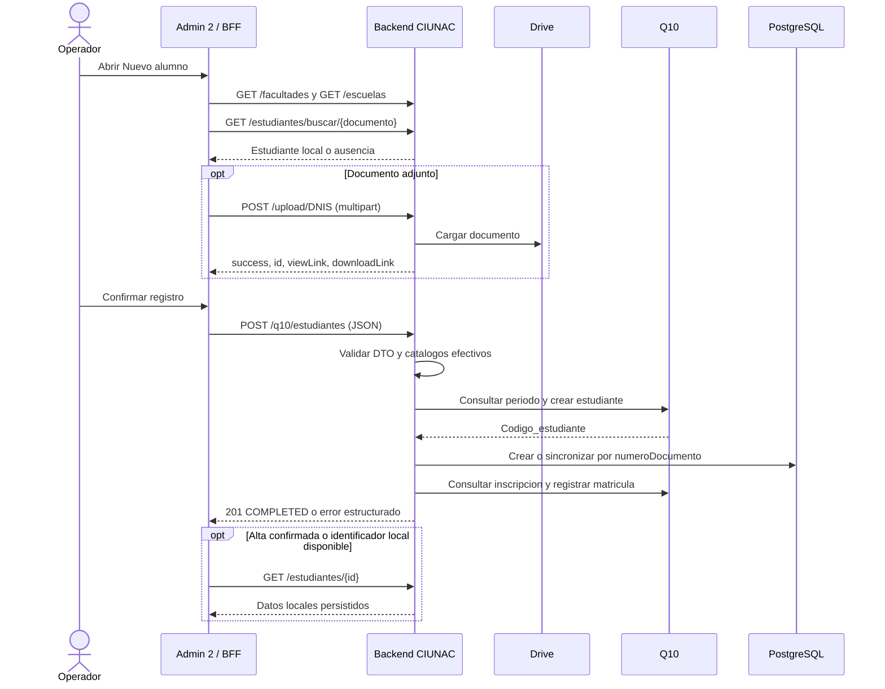

# CIUNAC Admin 2: administracion de estudiantes y alumno nuevo

## 1. Entrega y alcance

- Destinatario: agente de desarrollo del repositorio `ciunac-admin-2`.
- Version del documento: 1.1, revisada el 2026-11-25.
- Fuente: controladores y DTO del backend CIUNAC y [OpenAPI versionado](../api/openapi.json). Las rutas y ejemplos de este archivo se pueden usar aunque se entregue por separado al repositorio frontend.
- Contratos HTTP: comportamiento actual del codigo, no funcionalidades propuestas.
- Pantallas, rutas frontend y criterios FE: especificacion para implementar; no se afirma que ya existan ni que esten verificados.
- Relacion SDD: HU-EST-001, HU-EST-002 y HU-Q10-002. Los CA-FE de este documento son criterios frontend pendientes, no evidencia de pruebas ejecutadas.

**Encargo al agente:** implementar un espacio administrativo de estudiantes con listado, busqueda, filtros, detalle, edicion local y alta de alumno nuevo mediante Q10. Revisar primero el router, componentes, sesion, permisos y cliente HTTP existentes del portal; reutilizar sus patrones. No crear una landing page ni modificar el backend para acomodar la pantalla.

El listado consume `GET /estudiantes` y renderiza `data` con el paginador de `meta`. Para un documento exacto, usa `GET /estudiantes/buscar/:dni`. Para abrir o editar un alumno usa su UUID local en `GET /estudiantes/:id` y `PATCH /estudiantes/:id`.

El flujo principal de alta es una sola operacion de negocio: cargar documento opcional, crear en Q10, sincronizar el estudiante local e inscribirlo en el programa. No hacer un segundo `POST /estudiantes` despues del alta Q10.

**Cambio importante frente a ejemplos antiguos:** el alta admite `codigo` local opcional. Todos los errores de registro Q10 actuales usan `retryAllowed: false`, incluido `Q10_UNAVAILABLE`. No implementar reintentos automaticos.

## 2. Conexion, seguridad y limites

| Aspecto                             | Contrato o recomendacion                                                                                                                                                                 |
| ----------------------------------- | ---------------------------------------------------------------------------------------------------------------------------------------------------------------------------------------- |
| Backend local directo               | Configurar la URL base en el servidor del portal. Nest usa `PORT` y, si falta, `3000`. En Docker o detras de un proxy usar el puerto publicado. |
| Prefijo                             | Nest no configura `/api/ciunac`. Si el despliegue lo utiliza, corresponde al proxy. No duplicarlo ni retirarlo sin revisar la configuracion real del portal.                             |
| Autorizacion de las rutas descritas | `x-api-key: <API_KEY_BACKEND>`. Los controllers usan `ApiKeyGuard`, no JWT ni permisos por usuario en estas operaciones.                                                                 |
| Acceso administrativo               | Reutilizar la sesion y autorizacion administrativa del portal en su capa servidor. Una API key no identifica al operador ni sustituye la autorizacion.                                   |
| Secretos                            | La API key debe permanecer en servidor/BFF. No incluirla en variables publicas, bundle, almacenamiento del navegador, ejemplos con valores reales ni logs.                               |
| Capa de integracion                 | Navegador -> capa servidor/BFF autenticada del portal -> backend. Reutilizarla si existe; si no, definirla como tarea frontend/servidor, no inventar rutas adicionales del backend Nest. |
| JSON                                | `Content-Type: application/json`. No enviar propiedades ajenas al DTO: `whitelist` y `forbidNonWhitelisted` estan activos.                                                               |
| Multipart                           | Usar `FormData`; no fijar manualmente `Content-Type`, para conservar el boundary.                                                                                                        |
| Swagger                             | `/api/docs` y `/api/docs-json`, disponibles fuera de produccion.                                                                                                                         |

Los ejemplos siguientes son solicitudes y respuestas **del backend**, no contratos de un BFF ya implementado. Si el portal tiene otro envoltorio de respuestas, crear un adaptador explicito y conservar los codigos, identificadores y estado de la operacion.

`src/main.ts` permite el origen `https://ciunac-admin-2.vercel.app` y `http://localhost:3000`. Otros puertos/origenes requieren coordinacion o el BFF; no asumir que CORS los acepta. `X-Correlation-Id` no figura en `allowedHeaders` y `X-Operation-Id` no esta expuesto mediante `exposedHeaders`: para llamadas directas cross-origin no asumir que esos headers se pueden enviar/leer desde JavaScript. El BFF puede gestionarlos sin esa limitacion del navegador.

## 3. Entorno administrativo a implementar

Las rutas de esta tabla son propuestas **frontend**. Adaptarlas al router existente sin confundirlas con los endpoints HTTP del backend.

| Vista         | Ruta sugerida             | Contenido y acciones                                                               |
| ------------- | ------------------------- | ---------------------------------------------------------------------------------- |
| Listado       | `/estudiantes`            | Tabla con busqueda, filtros y paginacion del backend, y accion Nuevo alumno.       |
| Alta          | `/estudiantes/nuevo`      | Formulario administrativo de alta Q10; confirmar datos antes de enviar.            |
| Detalle       | `/estudiantes/:id`        | Datos personales, academicos, codigo local, identificador Q10, documento y fechas. |
| Edicion local | `/estudiantes/:id/editar` | Cambios mediante PATCH local; advertir que no se sincronizan con Q10.              |

Requisitos de interfaz:

- Mantener navegacion, componentes e identidad visual del portal. Priorizar una interfaz operativa y compacta, no tarjetas decorativas ni textos de marketing.
- Mostrar en tabla nombres/apellidos, documento, codigo local, tipo de alumno, facultad, escuela y vinculo Q10. Correo, celular y DNI adjunto se consultan al abrir el detalle por UUID.
- Mostrar tipo omitido como Sin clasificar, nunca inferir `PRE` ni `PG`.
- Mostrar `idQ10` ausente como Sin vinculo Q10 local. Esto no demuestra que la persona no exista remotamente.
- No inventar estado Activo/Inactivo, historial academico ni matricula vigente: no son campos/consultas de este contrato. `programaRegistrado: true` confirma solo la operacion exitosa de alta.
- Busqueda sobre documento, nombres, apellidos, codigo y correo; filtros por tipo, facultad, escuela y presencia de `idQ10`. Reiniciar pagina al cambiar filtros.
- Solicitar una pagina a `GET /estudiantes` por cada cambio de pagina, busqueda o filtros. Renderizar `data`, usar `meta.total` y `meta.totalPages` en el paginador, y reiniciar `page` a 1 al cambiar busqueda, filtros o limite. El backend ordena por apellidos, nombres e ID.
- Estados visibles: carga, lista vacia, sin coincidencias, error con recuperacion de lectura, formulario modificado, subida, registro y resultado parcial/incierto.
- En movil usar tabla desplazable o una lista compacta accesible; sin superponer campos, botones ni etiquetas. Reutilizar iconos y modales del proyecto.
- Mantener filtros al volver del detalle y actualizar el registro despues de editar/crear, sin duplicarlo en la lista.

Historias funcionales de esta entrega frontend:

1. Como operador administrativo, consultar y localizar estudiantes sin confundir UUID, codigo local e identificador Q10.
2. Como operador, revisar sus datos y documento antes de iniciar otro registro.
3. Como operador, crear un alumno en Q10 y localmente mediante una sola accion, con datos academicos y documento opcionales.
4. Como operador, reconocer un fallo parcial sin volver a crear al alumno y comunicar su identificador de operacion a soporte.
5. Como operador, corregir datos locales conociendo que esos cambios no se propagan a Q10.

## 4. Secuencia de alumno nuevo



La consulta previa por documento sirve para orientar al operador; no garantiza unicidad ni autoriza repetir un alta remota. Es una busqueda local por numero, no una consulta a Q10 ni por combinacion tipo/numero.

1. Cargar catalogos y validar el formulario antes de enviar escrituras.
2. Consultar el numero de documento al solicitarlo el operador o con una consulta controlada; codificarlo con `encodeURIComponent`.
3. Si existe con `idQ10`, abrir su detalle y no ofrecer un nuevo alta equivalente. Si existe sin vinculo, advertirlo: la sincronizacion local puede reutilizarlo, pero la existencia remota debe revisarse antes de autorizar una creacion.
4. Si hay archivo seleccionado y aun no existe `viewLink` valido, cargarlo antes del POST Q10. Conservar el resultado en memoria mientras se corrige el formulario; no volver a subir el mismo archivo por cada validacion o render.
5. Construir el JSON mediante mapeo explicito de campos; no propagar con spread el objeto completo del formulario, una entidad consultada o la respuesta del upload.
6. Bloquear doble submit con un control de operacion en curso, ademas del boton deshabilitado. Desactivar retries, repeticion al recuperar conexion y reenvio offline en cualquier biblioteca HTTP/cache utilizada para esta mutacion.
7. Enviar una sola solicitud a Q10 y esperar la respuesta.
8. Con `201 COMPLETED`, conservar UUID local e `idQ10`, marcar la creacion como confirmada y consultar el detalle. Si falla este GET, permitir repetir solo la lectura: no informar que fallo el alta ni reenviar el POST.
9. En errores, seguir la matriz de la seccion 9. Un timeout, cierre de pagina o aborto de fetch despues de enviar el POST deja resultado incierto; no equivale a cancelar la escritura en el servidor.

Estados de formulario recomendados, no estados persistidos por el backend:

| Estado UI                  | Comportamiento                                                                                                      |
| -------------------------- | ------------------------------------------------------------------------------------------------------------------- |
| Edicion / validacion       | Corregir campos; aun no se confirma un alta.                                                                        |
| Subiendo documento         | Bloquear envio Q10 hasta obtener un enlace utilizable.                                                              |
| Registrando                | No permitir otra escritura ni cambio de identidad del formulario.                                                   |
| Alta confirmada            | Conservar identificadores y consultar/refrescar detalle.                                                            |
| Error corregible           | Corregir datos y permitir un nuevo envio explicito solo tras revisar el motivo.                                     |
| Resultado parcial/incierto | Conservar informacion segura de diagnostico y consultar/derivar; no habilitar Reintentar alta como accion generica. |

No persistir DNI, fotos, correo o el formulario completo en localStorage ni registrarlos en telemetria. No hay cola/outbox ni endpoint de reanudacion para completar los fallos parciales.

## 5. Inventario HTTP del modulo

Todas estas rutas requieren `x-api-key` en la llamada backend.

| Metodo | Ruta backend               | Entrada                                | Salida actual                                                                              |
| ------ | -------------------------- | -------------------------------------- | ------------------------------------------------------------------------------------------ |
| GET    | `/estudiantes`             | Pagina, limite, busqueda y filtros opcionales | `200`, objeto `{ data, meta }`. `400` si la consulta es invalida. |
| GET    | `/estudiantes/:id`         | UUID local                             | `200`, estudiante; puede responder sin cuerpo si no existe.                                |
| GET    | `/estudiantes/buscar/:dni` | Numero de documento                    | `200`, estudiante; puede responder sin cuerpo si no existe.                                |
| GET    | `/facultades`              | Ninguna                                | `200`, array de facultades.                                                                |
| GET    | `/escuelas`                | Ninguna                                | `200`, array de escuelas con facultad.                                                     |
| POST   | `/upload/DNIS`             | Multipart `file`, `nombre?`, `fileId?` | `201`, datos del archivo Drive.                                                            |
| POST   | `/q10/estudiantes`         | `Q10EstudianteDto`                     | `201 COMPLETED`, UUID local e identificador Q10.                                           |
| PATCH  | `/estudiantes/:id`         | Campos locales permitidos              | `200`, estudiante actualizado o cuerpo vacio si no existe. No escribe en Q10.              |
| POST   | `/estudiantes`             | `CreateEstudianteDto` local            | `201`, estudiante local. Alternativa separada, no parte del alta Q10.                      |
| DELETE | `/estudiantes/:id`         | UUID local                             | `200`, `{ "message": "Estudiante eliminado" }` si se elimina. Fuera del minimo de esta UI. |

### 5.1 Listado paginado

Todos los parametros de consulta son opcionales.

| Parametro | Valores y comportamiento |
| --- | --- |
| `page` | Entero positivo. Por defecto, 1. |
| `limit` | Entero de 1 a 100. Por defecto, 25. |
| `search` | Texto con coincidencia parcial por numero de documento, codigo local, nombres y apellidos o correo. Ignora mayusculas, recorta espacios de los extremos y omite terminos vacios. Conserva ceros iniciales y trata `%` y `_` como texto literal. |
| `tipoEstudiante` | `PRE`, `POS`, `PG` o `SIN_CLASIFICAR`. El filtro `SIN_CLASIFICAR` corresponde a filas con `tipoEstudiante: null`. |
| `facultadId`, `escuelaId` | IDs enteros positivos del catalogo local. Se pueden enviar por separado o juntos. |
| `vinculadoQ10` | `true` para alumnos con `idQ10` local informado. `false` para alumnos con ID nulo o en blanco. Omitir para consultar ambos grupos. |

Enviar solo los parametros admitidos, una vez por clave. Usar `URLSearchParams` o el serializador del cliente HTTP para codificar la busqueda y enviar `vinculadoQ10=false` cuando este seleccionado ese filtro. La respuesta refleja la interseccion de todos los filtros. El orden es ascendente por apellidos, nombres y UUID.

Ejemplo de consulta y respuesta:

```http
GET /estudiantes?page=1&limit=25&search=00123&tipoEstudiante=PRE&vinculadoQ10=true
```

```json
{
  "data": [
    {
      "id": "c65ee499-6495-46ee-83c2-17785423fbaf",
      "nombres": "Ana",
      "apellidos": "Perez Lopez",
      "tipoDocumento": "DNI",
      "numeroDocumento": "00123456",
      "codigo": "00123456",
      "tipoEstudiante": "PRE",
      "idQ10": "Q10-123",
      "facultadId": 3,
      "escuelaId": 8,
      "facultad": { "id": 3, "nombre": "Facultad de Ingenieria" },
      "escuela": { "id": 8, "nombre": "Escuela de Ingenieria" }
    }
  ],
  "meta": { "page": 1, "limit": 25, "total": 1, "totalPages": 1 }
}
```

- `data` contiene solo las filas de la pagina. `meta.page` y `meta.limit` reflejan la consulta y `meta.total` cuenta todas las coincidencias. `meta.totalPages` indica cuantas paginas forman ese total.
- `200` con `data: []` y `meta.total: 0` indica que la consulta no tuvo coincidencias. Si `data` esta vacio, pero `meta.total` es mayor que cero, la pagina solicitada quedo fuera de rango. Navegar a `meta.totalPages` con los mismos filtros. Deshabilitar el paginador cuando `meta.totalPages` sea cero.
- Reiniciar a la pagina 1 al cambiar busqueda, filtros o limite. Al escribir, aplicar una espera breve antes de consultar y descartar respuestas de consultas anteriores. Conservar la consulta al volver del detalle y refrescar la pagina despues de un alta o una edicion.
- `400` indica parametros invalidos, por ejemplo `limit=101`. Mostrar el error de consulta y mantener los filtros editables. `401` del backend indica un problema de API key y debe manejarse en la capa servidor.

Desplegar el consumidor junto con la version del backend que devuelve `{ data, meta }`. Los clientes del array anterior deben actualizar la lectura de la respuesta y delegar la paginacion al servidor.

### 5.2 Consultas de detalle y busqueda exacta

Los GET por ID/documento y el PATCH no garantizan un `404` al faltar el registro. Leer primero el texto de respuesta y parsear JSON solo si hay contenido; aceptar tambien `null` defensivamente. No tratar un `200` vacio como un estudiante valido ni llamar `response.json()` incondicionalmente. En un PATCH vacio, no mostrar Guardado.

No habilitar borrado fisico de estudiantes por defecto: puede romper referencias o fallar por solicitudes/otras relaciones. No existe soft delete ni una garantia de `409` normalizado para esos fallos. Cualquier habilitacion requiere una decision de producto y revision del flujo por separado.

## 6. Catalogos y consulta local

### 6.1 Facultades y escuelas

Ejemplo de `GET /facultades`:

```json
[{ "id": 3, "nombre": "Facultad de Ingenieria", "codigo": "FI" }]
```

Ejemplo de `GET /escuelas`:

```json
[
  {
    "id": 8,
    "nombre": "Escuela de Ingenieria",
    "facultadId": 3,
    "tipo": "PRE",
    "facultad": { "id": 3, "nombre": "Facultad de Ingenieria", "codigo": "FI" }
  }
]
```

IDs, nombres y codigos de todos los ejemplos son ilustrativos. Consultar los catalogos reales del ambiente; no hardcodear `3`/`8`.

- Las escuelas admiten `tipo: PRE`, `POS` o `null` historico. `PG` no es un tipo de escuela.
- Filtrar escuelas por `facultadId` si hay facultad elegida; para estudiantes PRE/POS, ademas exigir el mismo tipo. Una escuela sin clasificar no es seleccionable para PRE/POS.
- Al cambiar facultad o tipo, limpiar una escuela seleccionada que ya no sea compatible. No reclasificar escuelas automaticamente desde el formulario de alumno.
- `tipoEstudiante`, facultad y escuela siguen siendo opcionales para todos los tipos. No convertirlos en obligatorios por una suposicion frontend. `PG` puede tener relaciones academicas si se proporcionan y son compatibles entre si.
- Si se elige escuela sin facultad, la UI puede completar la facultad a partir del catalogo, pero debe enviar ese ID explicitamente: el backend no lo infiere.
- Para un registro local existente, omisiones/null usan relaciones y tipo persistidos al validar el alta Q10. Omitir una facultad no elimina una incompatibilidad ya existente.
- No hay endpoint de catalogo de programas Q10 en este controlador. `Codigo_programa` debe provenir de la fuente ya validada del portal/configuracion acordada con negocio. No asumir que el ID o codigo de `/idiomas` equivale a un programa Q10.

### 6.2 Detalle del estudiante

Ejemplo de `GET /estudiantes/c65ee499-6495-46ee-83c2-17785423fbaf` con los campos que debe consumir la pantalla:

```json
{
  "id": "c65ee499-6495-46ee-83c2-17785423fbaf",
  "nombres": "Ana Maria",
  "apellidos": "Perez Lopez",
  "genero": "F",
  "fechaNacimiento": "2000-01-01",
  "tipoDocumento": "DNI",
  "numeroDocumento": "12345678",
  "celular": "999999999",
  "email": "ana@example.com",
  "direccion": "Lima",
  "tipoEstudiante": "PRE",
  "codigo": "0012345678",
  "idQ10": "Q10-12345",
  "facultadId": 3,
  "escuelaId": 8,
  "imgDoc": "https://drive.google.com/file/d/DRIVE_FILE_ID/view",
  "facultad": { "id": 3, "nombre": "Facultad de Ingenieria", "codigo": "FI" },
  "escuela": {
    "id": 8,
    "nombre": "Escuela de Ingenieria",
    "facultadId": 3,
    "tipo": "PRE"
  },
  "creadoEn": "2026-11-25T15:00:00.000Z",
  "modificadoEn": "2026-11-25T15:00:00.000Z"
}
```

El listado proyecta campos de la tabla y devuelve facultad/escuela como `{ id, nombre }` o `null`. Para correo, celular y documento adjunto, usar el detalle por ID. La busqueda exacta por documento carga `usuario`; el BFF debe excluir esa relacion al reenviar la respuesta al navegador.

Distinguir identificadores:

| Campo             | Significado                                                        | Edicion                                                                                  |
| ----------------- | ------------------------------------------------------------------ | ---------------------------------------------------------------------------------------- |
| `id`              | UUID de la tabla estudiantes, usado en rutas y relaciones locales. | Nunca editable.                                                                          |
| `idQ10`           | `Codigo_estudiante` devuelto por Q10 y guardado en `id_q10`.       | No se envia al alta ni al PATCH generico.                                                |
| `codigo`          | Codigo de alumno local, texto con ceros iniciales.                 | Opcional; no reemplaza UUID ni idQ10.                                                    |
| `Codigo_programa` | Programa usado al crear en Q10.                                    | Campo del alta, no identificador del alumno ni campo persistido por este contrato local. |

No habilitar una accion Sincronizar Q10 sobre el POST de alta: no existe un endpoint de actualizacion/sincronizacion remota seguro en este alcance.

## 7. Contrato de upload de DNI

```http
POST /upload/DNIS
x-api-key: <API_KEY_BACKEND>
Content-Type: multipart/form-data; boundary=<generado por FormData>
```

| Campo multipart | Obligatorio | Uso                                                                                             |
| --------------- | ----------- | ----------------------------------------------------------------------------------------------- |
| `file`          | Si          | Archivo binario; no usar `dni`, `imgDoc` ni `img_doc` como nombre del campo binario.            |
| `nombre`        | No          | Nombre sin extension; si se omite se usa el nombre original.                                    |
| `fileId`        | No          | ID Drive de un archivo a reemplazar. En alta nueva omitir; no confundir con UUID local o idQ10. |

Respuesta `201` de ejemplo:

```json
{
  "success": true,
  "id": "DRIVE_FILE_ID",
  "name": "documento-prueba.jpg",
  "folder": "DNIS",
  "viewLink": "https://drive.google.com/file/d/DRIVE_FILE_ID/view",
  "downloadLink": "https://drive.google.com/uc?id=DRIVE_FILE_ID&export=download"
}
```

Usar exactamente `viewLink` como `imgDoc` del JSON Q10. La respuesta no tiene un campo `url` y el upload no actualiza estudiantes por si solo. Verificar `success === true` y que `viewLink` sea una URL HTTP/HTTPS no vacia; el servicio puede devolver enlaces vacios si Drive no los proporciona.

No enviar imagenes base64 ni `File` dentro del JSON Q10. El limite JSON de ese endpoint es 100 KB; no es un limite multipart para DNI. El upload actual no define una politica funcional explicita de formatos/tamanos ni una validacion MIME/extension de DNI. Acordar los limites frontend antes de presentarlos como regla; no afirmar que el backend los garantiza. Los errores de upload conservan el formato normal de Nest y no el sobre especial de Q10; archivo ausente puede producir `500` generico.

**Privacidad pendiente:** el servicio establece lectura publica por enlace en Drive. No publicar previews de DNI en tablas ni registrar sus URLs. Abrir el enlace solo por accion autorizada, con protocolo validado y `rel="noopener noreferrer"` si se usa otra pestana. Una URL `viewLink` puede ser una pagina de Drive, no una imagen utilizable directamente en ``. La aprobacion de esta politica y su hardening son una tarea separada, no una capacidad que deba simular el frontend.

Si el operador cancela o falla el alta despues de subir, el archivo puede quedar huerfano. No existe limpieza automatica ni un endpoint de borrado DNIS en este flujo. Conservar el enlace en memoria para correcciones durante la misma sesion, sin volver a subirlo innecesariamente.

## 8. Contrato de alta Q10

### 8.1 Solicitud

```http
POST /q10/estudiantes
Content-Type: application/json
x-api-key: <API_KEY_BACKEND>
```

Ejemplo con los datos locales opcionales:

```json
{
  "Primer_nombre": "Ana",
  "Segundo_nombre": "Maria",
  "Primer_apellido": "Perez",
  "Segundo_apellido": "Lopez",
  "Email": "ana@example.com",
  "Codigo_tipo_identificacion": "PE01",
  "Numero_identificacion": "12345678",
  "Genero": "F",
  "Fecha_nacimiento": "2000-01-01",
  "Telefono": "014444444",
  "Celular": "999999999",
  "Direccion": "Lima",
  "Codigo_programa": "INGLES",
  "tipoEstudiante": "PRE",
  "codigo": "0012345678",
  "facultadId": 3,
  "escuelaId": 8,
  "imgDoc": "https://drive.google.com/file/d/DRIVE_FILE_ID/view"
}
```

`INGLES` es un ejemplo, no un codigo remoto garantizado. Reemplazar documento, correo, catalogos, programa y enlace por datos autorizados de prueba. No hacer altas reales para diagnosticar la pantalla sin autorizacion.

| Campo JSON                   | Obligatorio DTO | Regla actual / mapeo del formulario                                                                                                                  |
| ---------------------------- | --------------- | ---------------------------------------------------------------------------------------------------------------------------------------------------- |
| `Primer_nombre`              | Si              | Texto no vacio.                                                                                                                                      |
| `Segundo_nombre`             | No              | Texto opcional; omitir si no existe.                                                                                                                 |
| `Primer_apellido`            | Si              | Texto no vacio.                                                                                                                                      |
| `Segundo_apellido`           | Si              | Texto no vacio en el contrato actual; no omitir ni inventar un apellido para pasar validacion.                                                       |
| `Email`                      | Si              | Email valido.                                                                                                                                        |
| `Codigo_tipo_identificacion` | Si              | `PE01` = DNI, `PE02` = CE, `PE03` = pasaporte en el mapeo local.                                                                                     |
| `Numero_identificacion`      | Si              | Texto no vacio; conservar ceros iniciales. No se impone aqui longitud universal de DNI a todos los tipos de documento.                               |
| `Genero`                     | Si              | `M` o `F`.                                                                                                                                           |
| `Fecha_nacimiento`           | Si              | DTO Q10 exige texto no vacio. En UI usar fecha calendario real `YYYY-MM-DD`, sin hora ni conversion a ISO timestamp. Ver diferencia local mas abajo. |
| `Telefono`                   | Si              | Texto no vacio; no asumir que Celular lo reemplaza.                                                                                                  |
| `Celular`                    | Si              | Texto no vacio.                                                                                                                                      |
| `Codigo_programa`            | Si              | Texto no vacio y valor remoto valido acordado.                                                                                                       |
| `Direccion`                  | No              | Texto opcional; se usa para el dato local. El payload remoto actual lo sobrescribe con Lima.                                                         |
| `tipoEstudiante`             | No              | `PRE`, `POS`, `PG` o `null`. Sin valor predeterminado.                                                                                               |
| `codigo`                     | No              | Texto, trim en extremos, de 1 a 50 caracteres despues de trim. Numeros/booleanos/arrays no se admiten; conservar ceros iniciales.                    |
| `facultadId`                 | No              | Entero positivo de catalogo local o `null`. No enviar el objeto facultad.                                                                            |
| `escuelaId`                  | No              | Entero positivo de catalogo local o `null`; existencia, pertenencia y tipo segun seccion 6.                                                          |
| `imgDoc`                     | No              | URL absoluta HTTP/HTTPS no vacia o `null`. No binario, base64, ID Drive aislado ni objeto upload.                                                    |

Tambien admite opcionalmente `Lugar_nacimiento`, `Lugar_residencia` (texto), `Consecutivo_sedejornada` y `Consecutivo_periodo` (numero). No pedirlos como obligatorios ni exponerlos como selectores funcionales: el backend sobrescribe esos valores remotos. Resuelve su periodo por mayor `Ordenamiento` y usa su sede/jornada configurada.

Reglas de serializacion:

- Los cinco campos `tipoEstudiante`, `codigo`, `facultadId`, `escuelaId` e `imgDoc` solo se guardan en PostgreSQL, no se envian a Q10. Omitidos o `null` conservan valores locales previos; en un nuevo registro quedan sin valor. No sirven para borrar datos.
- Un `codigo` opcional vacio en el formulario se omite; no enviar `""` ni convertirlo a numero. Un codigo no vacio se envia como string tras trim.
- IDs seleccionados se envian como numeros, no textos, objetos ni cadenas `"null"`/`"undefined"`. Campo no seleccionado: omitir preferentemente.
- Usar `imgDoc`, nunca `img_doc`. La segunda es el nombre SQL y produce `400` como propiedad desconocida en JSON.
- No enviar `id`, `idQ10`, `Codigo_estudiante`, `fechaNacimiento`, nombres camelCase del CRUD local, metadatos UI, fechas de auditoria ni campos adicionales.
- No convertir la fecha con `new Date().toISOString()` en el formulario. El DTO Q10 no tiene la validacion estricta de calendario del DTO local y su servicio aun construye un `Date` al sincronizar. Comprobar la fecha devuelta y reportar una diferencia; no compensarla sumando/restando dias en pantalla.

### 8.2 Respuesta exitosa

HTTP `201 Created`; ejemplo:

```json
{
  "status": "COMPLETED",
  "estudiante": {
    "id": "c65ee499-6495-46ee-83c2-17785423fbaf",
    "idQ10": "Q10-12345",
    "numeroDocumento": "12345678"
  },
  "programaRegistrado": true
}
```

El header `X-Operation-Id` contiene un UUID de diagnostico. No se agrega al body exitoso.

La respuesta exitosa no incluye `codigo`, tipo, facultad, escuela ni imagen: consultar `GET /estudiantes/{estudiante.id}` para obtenerlos. No inventar que un valor `undefined` en el `201` significa que no se guardo. Los datos personales pueden provenir de la respuesta Q10, con fallback al formulario.

La idempotencia de `syncFromQ10` es local: mismo documento/mismo idQ10 puede reutilizar el registro. No garantiza que repetir `POST /q10/estudiantes` sea seguro. No existe clave de idempotencia HTTP ni operacion de compensacion global Drive/Q10/PostgreSQL.

## 9. Contrato de errores y recuperacion

Los errores del POST Q10 normalizados por `main.ts` contienen `statusCode`, `code`, `message`, `operationId`, `stage`, `origin`, `validationErrors` y `retryAllowed: false`. Pueden incluir `estudianteId`/`idQ10` en resultados parciales. Este formato no debe extrapolarse a todos los demas endpoints.

Ejemplo `400`, escuela incompatible:

```json
{
  "statusCode": 400,
  "code": "Q10_LOCAL_VALIDATION_FAILED",
  "message": "El tipo de la escuela indicada no coincide con el tipo del estudiante",
  "operationId": "ca5ae37f-84e6-4f59-b241-b13b9c29a5ea",
  "stage": "LOCAL_VALIDATION",
  "origin": "local",
  "validationErrors": [
    { "field": "escuelaId", "rules": ["SCHOOL_TYPE_MISMATCH"] }
  ],
  "retryAllowed": false
}
```

Ejemplo `502`, alumno guardado y matricula no confirmada:

```json
{
  "statusCode": 502,
  "code": "Q10_CREATED_PROGRAM_PENDING",
  "message": "El estudiante fue creado, pero su matricula quedo pendiente",
  "operationId": "ca5ae37f-84e6-4f59-b241-b13b9c29a5ea",
  "stage": "PROGRAM_REGISTRATION",
  "origin": "q10",
  "validationErrors": [],
  "retryAllowed": false,
  "estudianteId": "c65ee499-6495-46ee-83c2-17785423fbaf",
  "idQ10": "Q10-12345"
}
```

La etapa de un error de matricula tambien puede ser `ENROLLMENT_LOOKUP`. No clasificar por una sola etapa o por el texto del mensaje.

| HTTP                                | `code`                                     | Accion frontend                                                                                                                          |
| ----------------------------------- | ------------------------------------------ | ---------------------------------------------------------------------------------------------------------------------------------------- |
| 400                                 | `Q10_INVALID_JSON`                         | Corregir serializacion; no se invoco Q10 en este intento.                                                                                |
| 400                                 | `Q10_REQUEST_VALIDATION_FAILED`            | Marcar campos segun `validationErrors`, corregir y permitir envio explicito.                                                             |
| 400                                 | `Q10_LOCAL_VALIDATION_FAILED`              | Actualizar catalogos/seleccion segun reglas locales antes de nuevo envio explicito.                                                      |
| 400                                 | `Q10_STUDENT_CREATION_REJECTED`            | Mostrar rechazo controlado y referencia de operacion; revisar con operador. No demuestra que el alumno no exista de un intento anterior. |
| 401                                 | `Q10_UNAUTHORIZED`                         | Revisar integracion/autorizacion del BFF. No pedir ni exponer API key al usuario.                                                        |
| 413                                 | `Q10_REQUEST_TOO_LARGE`                    | No enviar binario/base64; corregir el JSON. Limite del parser: 100 KB.                                                                   |
| 409                                 | `Q10_ID_CONFLICT`, `Q10_ID_ALREADY_LINKED` | Conflicto en sincronizacion local despues del alta remota. No repetir POST; consultar local si existe y escalar con operacion.           |
| 502                                 | `Q10_PERIOD_LOOKUP_FAILED`                 | No se envio alta en este intento; revisar Q10/periodo con soporte antes de otra accion explicita.                                        |
| 502                                 | `Q10_UNAVAILABLE`                          | Escritura remota incierta. Bloquear reintento generico y solicitar revision.                                                             |
| 502                                 | `Q10_CREATED_INVALID_RESPONSE`             | Exito remoto sin codigo utilizable. No repetir alta; revisar remotamente.                                                                |
| 502                                 | `Q10_CREATED_LOCAL_SYNC_FAILED`            | Q10 creado y fallo local; conservar idQ10 para atencion autorizada, sin nuevo POST.                                                      |
| 502                                 | `Q10_CREATED_PROGRAM_PENDING`              | Consultar local por `estudianteId`; informar matricula pendiente de confirmacion, sin volver a crear.                                    |
| 500                                 | `Q10_INTERNAL_ERROR`                       | Revisar etapa/operacion y efectos con soporte; no presumir rollback.                                                                     |
| Sin respuesta / error no reconocido | No disponible o desconocido                | Resultado incierto si se envio la escritura. No reintentar automaticamente.                                                              |

Reglas locales conocidas: `FACULTY_NOT_FOUND`, `SCHOOL_NOT_FOUND`, `SCHOOL_FACULTY_MISMATCH`, `SCHOOL_UNCLASSIFIED`, `SCHOOL_TYPE_MISMATCH`. Las reglas DTO usan nombres de class-validator (`isEmail`, `isInt`, `min`, `isUrl`, `isLength`, etc.). Una propiedad no permitida se reporta como `field: "unknown"`, `rules: ["whitelistValidation"]`; no asumir que el backend devolvera su nombre original.

- `origin` es `request`, `local` o `q10`. Las etapas son `REQUEST_VALIDATION`, `LOCAL_VALIDATION`, `PERIOD_LOOKUP`, `REMOTE_CREATE`, `LOCAL_SYNC`, `ENROLLMENT_LOOKUP`, `PROGRAM_REGISTRATION`, `COMPLETED`.
- La referencia `operationId` del error es un UUID por solicitud, distinto del operationId fijo Swagger `Q10Controller_register`. No da idempotencia ni permite reanudar.
- El BFF puede enviar `X-Correlation-Id` UUID valido y conservar la correlacion con el `operationId` generado por backend. Usar identificadores tecnicos aleatorios, no DNI ni email.
- Mostrar un mensaje comprensible, campos corregibles y referencia de operacion. No extraer reglas desde mensajes libres de Q10 ni imprimir payloads, imagenes, URLs privadas o entidades completas en consola/analytics.
- Reintentar una lectura es distinto de repetir una escritura. Consultar el registro local no confirma ni descarta por si solo la existencia de un estudiante remoto o su matricula.

## 10. Edicion y alternativa solo local

### 10.1 Edicion local

```http
PATCH /estudiantes/c65ee499-6495-46ee-83c2-17785423fbaf
Content-Type: application/json
x-api-key: <API_KEY_BACKEND>
```

Ejemplo:

```json
{
  "celular": "988888888",
  "email": "ana.nuevo@example.com",
  "tipoEstudiante": "PRE",
  "codigo": "0012345678",
  "facultadId": 3,
  "escuelaId": 8,
  "imgDoc": "https://drive.google.com/file/d/DRIVE_FILE_ID/view"
}
```

Campos admitidos por `UpdateEstudianteDto`: `nombres`, `apellidos`, `genero`, `fechaNacimiento`, `tipoDocumento`, `numeroDocumento`, `celular`, `imgDoc`, `tipoEstudiante`, `facultadId`, `escuelaId`, `codigo`, `direccion`, `email`. Enviar solo campos modificados y admitidos, no relaciones ni campos de auditoria.

- Devuelve `200` con el estudiante actualizado, no el sobre `COMPLETED` de Q10. Si no existe, puede devolver cuerpo vacio.
- No actualiza datos en Q10, no matricula y no modifica `idQ10`. Dejar visible esta diferencia en el formulario/confirmacion administrativa.
- No habilitar inicialmente cambios de identidad (`tipoDocumento`/`numeroDocumento`) para alumnos vinculados a Q10 sin una politica aprobada; aunque el DTO los admite, no hay sincronizacion remota ni reconciliacion automatica por este PATCH.
- `fechaNacimiento` omitida conserva la existente; si se envia exige fecha real `YYYY-MM-DD`, sin `null` ni timestamps.
- `tipoEstudiante` e `imgDoc` omitidos o `null` no borran lo existente. Para relaciones/codigo enviar solo cambios explicitos; no asumir que toda propiedad nullable usa las mismas reglas de conservacion que el alta Q10.
- El CRUD local no valida email, URL de imagen, longitud de codigo ni todos los escenarios de catalogos exactamente igual que Q10. La UI debe validar valores utiles y longitud de codigo hasta 50 por la columna, pero no declarar que el servidor aplica las mismas reglas en ambos DTOs. Un formulario vacio no debe convertirse en un borrado por envio masivo de `null`.

### 10.2 Creacion exclusivamente local

El backend ofrece `POST /estudiantes`, pero no debe ser la accion principal Nuevo alumno de este encargo ni un fallback si falla Q10. Habilitarlo solo si negocio solicita expresamente registros sin Q10, con una accion claramente separada.

Usa nombres camelCase (`nombres`, `apellidos`, `tipoDocumento`, `numeroDocumento`, `fechaNacimiento`, etc.), exige `nombres`, `apellidos`, `tipoDocumento`, `numeroDocumento`, `celular` y fecha calendario real `fechaNacimiento`; no recibe `Codigo_programa` ni los campos Q10. `genero` es opcional en DTO pero la entidad no admite nulos: solicitarlo en la UI si se habilita este modo. Devuelve el estudiante local con `201`, no el sobre de alta Q10, y no envia correo ni crea usuario de acceso automaticamente.

## 11. Plan de implementacion frontend

1. Inspeccionar `ciunac-admin-2`: framework/router, modulo de estudiantes existente, componentes de tabla/formulario, permisos, sesion, BFF y manejo global de errores/retries. No reemplazar arquitectura sin necesidad.
2. Implementar/reutilizar cliente servidor con base URL configurable, API key privada, respuestas vacias seguras, proyeccion de datos y normalizacion diferenciada Q10/Nest/BFF. Preservar status y diagnostico seguro.
3. Implementar listado paginado y filtros por API, detalle y busqueda por documento con estados de carga/error y navegacion coherente.
4. Construir formulario de alta con mapeo explicito, catalogos dependientes, programa validado, fecha calendario y codigo como texto.
5. Integrar upload opcional, resultado reutilizable en memoria, confirmacion y unica mutacion Q10 sin reintentos automaticos.
6. Implementar resultados confirmados, errores corregibles y resultados inciertos/parciales; evitar que un GET fallido reactive la creacion.
7. Agregar edicion local limitada y declarada como tal; mantener identidad e idQ10 protegidos segun las restricciones anteriores.
8. Agregar pruebas de componentes/adaptadores y e2e con servicios simulados; revisar desktop/movil y entregar capturas/evidencia. Las altas reales autorizadas son una verificacion separada, no una prueba de interfaz repetible.

No exigir cambios SQL desde el frontend. Coordinar que el backend desplegado corresponda a este contrato, con `id_q10`, `tipo_estudiante`, `codigo`, `img_doc`, `facultad_id`, `escuela_id` y `escuelas.tipo` disponibles, y escuelas PRE/POS clasificadas. Los scripts existentes y su aplicacion corresponden al procedimiento backend; esta guia no autoriza ejecutarlos en produccion.

## 12. Criterios frontend y pruebas requeridas

Estado inicial de todos estos criterios: **Especificado, pendiente de implementacion y prueba en ciunac-admin-2**. Reusar los IDs para enlazar tests y pull request; no marcarlos Verificado solo por leer este documento.

| Criterio     | Escenario y evidencia esperada                                                                                                                                                                 |
| ------------ | ---------------------------------------------------------------------------------------------------------------------------------------------------------------------------------------------- |
| CA-FE-EST-01 | Listado renderiza `data`, pagina con `meta`, envia filtros a la API y reinicia la pagina al cambiar la consulta. Distingue sin coincidencias, pagina fuera de rango y error. Conserva filtros al volver del detalle. |
| CA-FE-EST-02 | GET por ID/documento `200` vacio o `null` muestra ausencia sin error de parseo; PATCH vacio no muestra guardado exitoso.                                                                       |
| CA-FE-EST-03 | Se distinguen UUID, codigo local con ceros iniciales e idQ10; sin idQ10 no se afirma inexistencia remota.                                                                                      |
| CA-FE-EST-04 | PRE/POS filtra escuela por tipo y facultad; cambiar seleccion invalida escuela incompatible; no convierte catalogos opcionales en obligatorios.                                                |
| CA-FE-EST-05 | PG y tipo omitido se admiten sin facultad/escuela/documento; no hay tipo por defecto.                                                                                                          |
| CA-FE-EST-06 | Codigo se envia como string trim, preserva ceros y omite vacio; valida maximo 50. imgDoc usa URL, no img_doc ni binario.                                                                       |
| CA-FE-EST-07 | Upload usa multipart file y obtiene viewLink; enlace vacio/error impide continuar con ese adjunto. Omitir DNI permite continuar.                                                               |
| CA-FE-EST-08 | JSON Q10 contiene solo DTO admitido y todos los campos obligatorios; Fecha_nacimiento conserva YYYY-MM-DD.                                                                                     |
| CA-FE-EST-09 | Doble clic, reconexion, re-render y retry global no producen un segundo POST Q10; no hay POST local posterior.                                                                                 |
| CA-FE-EST-10 | `201` conserva IDs y consulta detalle para verificar tipo/codigo/facultad/escuela/imagen; GET posterior fallido permite solo recuperar lectura.                                                |
| CA-FE-EST-11 | `400` estructura errores por campo/regla, incluido unknown/whitelist; un rechazo remoto no se interpreta como inexistencia del alumno.                                                         |
| CA-FE-EST-12 | `401`/`413`, periodo fallido, `409`, los cinco codigos `502` y `500` tienen manejo explicito sin retry automatico.                                                                             |
| CA-FE-EST-13 | Matricula pendiente conserva estudianteId/idQ10 y permite consultar local, sin repetir alta ni inventar endpoint de reanudacion.                                                               |
| CA-FE-EST-14 | Timeout/aborto/desconexion tras envio se trata como resultado incierto; se preserva diagnostico seguro y no se anuncia rollback.                                                               |
| CA-FE-EST-15 | PATCH usa solo campos modificados, no edita idQ10, no promete sincronizacion Q10 y conserva fecha cuando se omite.                                                                             |
| CA-FE-EST-16 | Sesion administrativa protege la capa servidor; API key y credenciales no aparecen en bundle, respuestas, consola ni almacenamiento publico. No se reexpone usuario/password/refreshTokenHash. |
| CA-FE-EST-17 | Formularios/tablas funcionan en desktop y movil, con teclado, foco, errores asociados a campos y botones estables sin superposiciones.                                                         |
| CA-FE-EST-18 | Pruebas de listado cubren pagina 1 y 2, busqueda con ceros iniciales, filtros combinados con `vinculadoQ10=false`, y respuestas `400` y `401`. La tabla utiliza los totales del backend para activar los controles de pagina. |

Pruebas minimas: adaptador JSON/multipart/respuesta vacia, mapeo de payloads, filtros de catalogos, estados de formulario y e2e de exito/error con Q10/Drive simulados. Para cada criterio registrar archivo de test, resultado, commit y captura cuando sea visual. No almacenar datos personales reales en fixtures ni ejecutar POST reales en Q10 desde CI.

## 13. Fuentes y pendientes separados

- [OpenAPI versionado](../api/openapi.json) y [guia de errores Q10](q10-registration-errors.md).
- [Feature estudiante nuevo](../specs/estudiante-nuevo.md), [principales](../specs/principales.md), [Q10](../specs/q10.md), [upload](../specs/uploads-mailer.md).
- [Q10Controller](../../src/q10/q10.controller.ts), [DTO de alta](../../src/q10/dto/q10-estudiante.dto.ts), [DTO de respuestas](../../src/q10/dto/q10-estudiante-response.dto.ts), [servicio Q10](../../src/q10/q10.service.ts), [diagnostico HTTP](../../src/q10/q10-operation.ts).
- [EstudiantesController](../../src/modules/principales/estudiantes/estudiantes.controller.ts), [params del listado](../../src/modules/principales/estudiantes/dto/listar-estudiantes.dto.ts), [respuesta paginada](../../src/modules/principales/estudiantes/dto/estudiantes-paginados.dto.ts), [servicio local](../../src/modules/principales/estudiantes/estudiantes.service.ts) y [DTO PATCH](../../src/modules/principales/estudiantes/dto/update-estudiante.dto.ts).
- [UploadController](../../src/shared/upload/upload.controller.ts), [servicio Drive](../../src/shared/upload/upload.service.ts), [configuracion global/CORS](../../src/main.ts).

Pendientes backend que no deben simularse en UI: catalogo remoto de programas, reanudacion e idempotencia HTTP del alta, actualizacion de alumnos en Q10, politica privada/limites de DNI, exclusiones seguras de usuario en la busqueda exacta por documento, uniformidad de validaciones local/Q10 y tratamiento de fechas del alta Q10. Si se necesitan, abrir tareas backend separadas con contratos y pruebas; no reutilizar POST de creacion como sustituto.
